# Agentic Harness Tips

What I set up in Claude Code besides prompting. One tip, one picture, one snippet.

<sub>24 tips · tracked through Claude Code 2.1.282 · updated 2026-10-07</sub>

**Check your own repo against this list:**

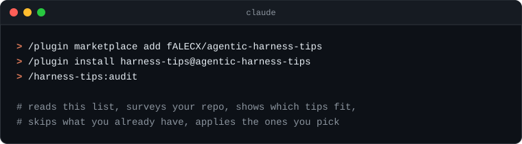

```text
/plugin marketplace add fALECX/agentic-harness-tips
/plugin install harness-tips@agentic-harness-tips
/harness-tips:audit
```

| Tip | When it pays off |
|:--|:--|
| **Models & output** | |
| [Plan with Opus, build with Sonnet](#opusplan) | Multi-file features, refactors, anything you'd sketch first. |
| [Dial effort per task](#effort) | Cost or speed matters, or you're deep in a hard bug. |
| [Cheap scouts, smart architects](#role-agents) | Large repos, long sessions, lots of delegation. |
| [Less narration, same work](#output-style) | You skim Claude's replies more than you read them. |
| **Hooks & guardrails** | |
| [Start every session briefed](#session-brief) | Always, in any git repo. |
| [Dev server starts itself](#dev-server) | `package.json` has a `dev` script (Vite, Next, Astro, …). |
| [Every edit comes out formatted](#format-on-edit) | Prettier, Biome, Ruff, gofmt: any formatter in the repo. |
| [No “done” until types pass](#stop-gate) | TypeScript, mypy, `cargo check`: any check that runs in under ~30 s. |
| [Deny the scary stuff](#deny-rules) | Before you turn on auto mode, `acceptEdits` or skip-permissions. |
| **Context & instructions** | |
| [One instruction file for every agent](#agents-md) | You or your teammates use more than one coding agent. |
| [Keep instructions to one screen](#lean-instructions) | `CLAUDE.md` or `AGENTS.md` is over ~100 lines, or is untouched `/init` output. |
| [Guard the context window](#context-hygiene) | Long sessions, or answers getting worse. |
| [Compact before it compresses itself](#compact) | A task is winding down, or the context bar is over half full. |
| [Prompted it twice? Make it a skill](#skills) | Releases, changelogs, review checklists, deploys. |
| **Workflow** | |
| [Parallel sessions, zero collisions](#worktrees) | One task is running and the next one is ready. |
| [Esc Esc is undo](#rewind) | Experiments, big refactors, “let's just try it”. |
| [Show, don't describe](#screenshots) | Frontend work, CSS bugs, design handoffs. |
| [! runs it yourself](#bang) | You already know the exact command. |
| [Review before you commit](#code-review) | Every non-trivial diff. |
| **Automation** | |
| [End permission-prompt fatigue](#fewer-prompts) | You click “Yes” on the same commands every day. |
| [Babysit CI with /loop](#loop) | Waiting on CI, a deploy or a flaky queue. |
| [Routines run while you sleep](#routines) | Recurring chores: dependency bumps, docs drift, PR review, triage. |
| [Let /insights find your next hook](#insights) | Once a month, or whenever your setup feels stale. |
| [Pipe it: claude -p](#headless) | Anything you'd script: commit messages, log triage, batch edits. |

## Models & output

<a id="opusplan"></a>

### Plan with Opus, build with Sonnet

`/model opusplan` runs Opus in plan mode and Sonnet once you approve. `Shift+Tab` toggles plan mode.

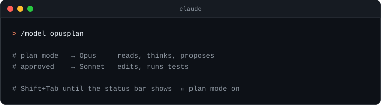

**When:** Multi-file features, refactors, anything you'd sketch first.

<details><summary>Copy · <code>~/.claude/settings.json</code></summary>

```json
{
  "model": "opusplan"
}
```

</details>

<a id="effort"></a>

### Dial effort per task

Low effort for boilerplate, `xhigh` for nasty bugs. Pin a default per model so you stop thinking about it.

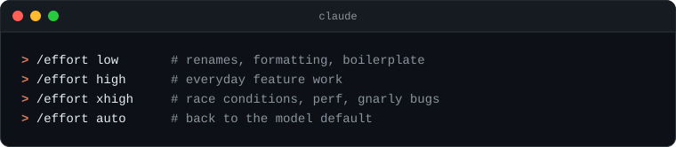

**When:** Cost or speed matters, or you're deep in a hard bug.

<details><summary>Copy · <code>~/.claude/settings.json</code></summary>

```json
{
  "effortLevel": "high",
  "modelSettings": {
    "claude-opus-5-5": { "effortLevel": "xhigh" }
  }
}
```

</details>

<a id="role-agents"></a>

### Cheap scouts, smart architects

Give every subagent the smallest model that does its job. Haiku explores, Sonnet builds and reviews, Opus plans.

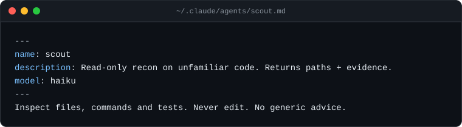

**When:** Large repos, long sessions, lots of delegation.  
**Note:** My set: `scout` → haiku · `implementer`, `reviewer` → sonnet · `architect` → opus.

<details><summary>Copy · <code>~/.claude/agents/scout.md</code></summary>

```md
---
name: scout
description: Read-only recon on unfamiliar code. Returns paths + evidence.
model: haiku
---
Inspect files, commands and tests. Never edit. No generic advice.
```

</details>

<a id="output-style"></a>

### Less narration, same work

`/output-style concise` puts the result first and drops the play-by-play. Easier to skim after a long run.

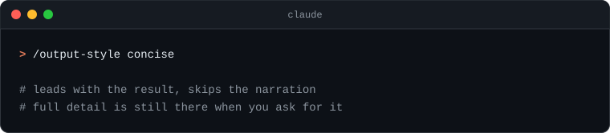

**When:** You skim Claude's replies more than you read them.

<details><summary>Copy · <code>~/.claude/settings.json</code></summary>

```json
{
  "outputStyle": "Concise"
}
```

</details>

## Hooks & guardrails

<a id="session-brief"></a>

### Start every session briefed

`SessionStart` output lands in Claude's context. Print branch, dirty files and recent commits so it never starts cold.

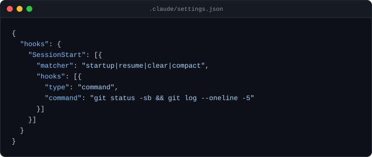

**When:** Always, in any git repo.  
**Note:** I also use this hook to flag repos that are missing `AGENTS.md`.

<details><summary>Copy · <code>.claude/settings.json</code></summary>

```json
{
  "hooks": {
    "SessionStart": [{
      "matcher": "startup|resume|clear|compact",
      "hooks": [{
        "type": "command",
        "command": "git status -sb && git log --oneline -5"
      }]
    }]
  }
}
```

</details>

<a id="dev-server"></a>

### Dev server starts itself

An async `SessionStart` hook boots `npm run dev` and logs to a file Claude can read when the UI breaks.

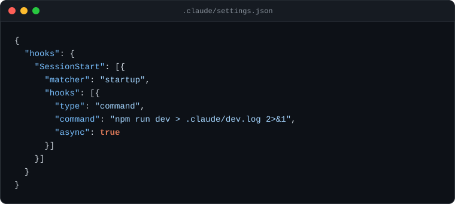

**When:** `package.json` has a `dev` script (Vite, Next, Astro, …).  
**Note:** Add to `CLAUDE.md`: *Dev server is already running, errors go to `.claude/dev.log`.* Git-ignore the log.

<details><summary>Copy · <code>.claude/settings.json</code></summary>

```json
{
  "hooks": {
    "SessionStart": [{
      "matcher": "startup",
      "hooks": [{
        "type": "command",
        "command": "npm run dev > .claude/dev.log 2>&1",
        "async": true
      }]
    }]
  }
}
```

</details>

<a id="format-on-edit"></a>

### Every edit comes out formatted

`PostToolUse` on `Edit|Write` runs your formatter on the file Claude just touched. Style nits never reach review.

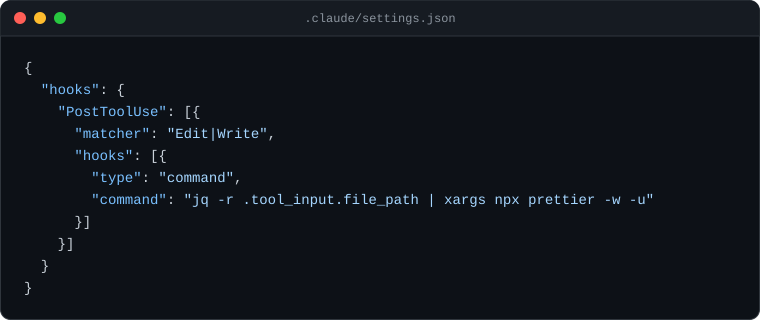

**When:** Prettier, Biome, Ruff, gofmt: any formatter in the repo.  
**Note:** Python: swap in `xargs ruff format`. Needs `jq`.

<details><summary>Copy · <code>.claude/settings.json</code></summary>

```json
{
  "hooks": {
    "PostToolUse": [{
      "matcher": "Edit|Write",
      "hooks": [{
        "type": "command",
        "command": "jq -r .tool_input.file_path | xargs npx prettier -w -u"
      }]
    }]
  }
}
```

</details>

<a id="stop-gate"></a>

### No “done” until types pass

A `Stop` hook runs the type-checker. Exit code 2 hands the errors back and Claude keeps fixing.

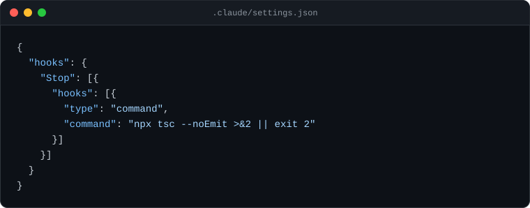

**When:** TypeScript, mypy, `cargo check`: any check that runs in under ~30 s.  
**Note:** Keep it fast. Full test suites belong in CI.

<details><summary>Copy · <code>.claude/settings.json</code></summary>

```json
{
  "hooks": {
    "Stop": [{
      "hooks": [{
        "type": "command",
        "command": "npx tsc --noEmit >&2 || exit 2"
      }]
    }]
  }
}
```

</details>

<a id="deny-rules"></a>

### Deny the scary stuff

Deny rules beat hoping. Block secrets, force-pushes and `rm -rf`, then run with fewer prompts without sweating.

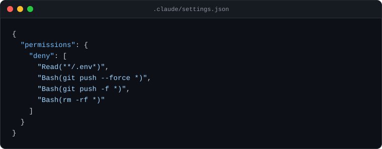

**When:** Before you turn on auto mode, `acceptEdits` or skip-permissions.

<details><summary>Copy · <code>.claude/settings.json</code></summary>

```json
{
  "permissions": {
    "deny": [
      "Read(**/.env*)",
      "Bash(git push --force *)",
      "Bash(git push -f *)",
      "Bash(rm -rf *)"
    ]
  }
}
```

</details>

## Context & instructions

<a id="agents-md"></a>

### One instruction file for every agent

Rules live in `AGENTS.md`, which Codex, Cursor and co. read too. `CLAUDE.md` just imports it, so the copies never drift.

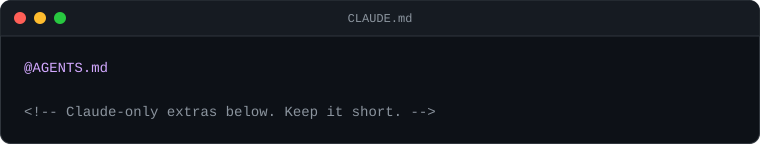

**When:** You or your teammates use more than one coding agent.

<details><summary>Copy · <code>CLAUDE.md</code></summary>

```md
@AGENTS.md

<!-- Claude-only extras below. Keep it short. -->
```

</details>

<a id="lean-instructions"></a>

### Keep instructions to one screen

Root instructions load every session. Keep commands, hard rules and gotchas there, and point to longer docs by path.

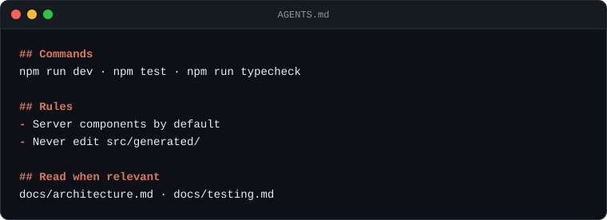

**When:** `CLAUDE.md` or `AGENTS.md` is over ~100 lines, or is untouched `/init` output.  
**Note:** No file yet? `/init` drafts one. Then cut it in half.

<details><summary>Copy · <code>AGENTS.md</code></summary>

```md
## Commands
npm run dev · npm test · npm run typecheck

## Rules
- Server components by default
- Never edit src/generated/

## Read when relevant
docs/architecture.md · docs/testing.md
```

</details>

<a id="context-hygiene"></a>

### Guard the context window

`/clear` between tasks, `/context` to see what eats tokens, `/btw` for side questions that shouldn't stick.

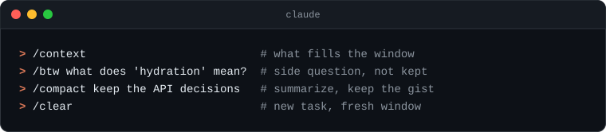

**When:** Long sessions, or answers getting worse.

<a id="compact"></a>

### Compact before it compresses itself

`/compact keep <what matters>` summarizes the window on your terms. Control what survives the summary instead of letting auto-compact decide.

**When:** A task is winding down, or the context bar is over half full.

<a id="skills"></a>

### Prompted it twice? Make it a skill

Repeated workflows become `.claude/skills/<name>/SKILL.md`. Claude loads it when the description matches, or you run `/<name>`.

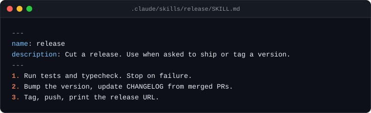

**When:** Releases, changelogs, review checklists, deploys.

<details><summary>Copy · <code>.claude/skills/release/SKILL.md</code></summary>

```md
---
name: release
description: Cut a release. Use when asked to ship or tag a version.
---
1. Run tests and typecheck. Stop on failure.
2. Bump the version, update CHANGELOG from merged PRs.
3. Tag, push, print the release URL.
```

</details>

## Workflow

<a id="worktrees"></a>

### Parallel sessions, zero collisions

`claude --worktree <name>` gives each session its own checkout and branch. Two features at once, no stepping on toes.

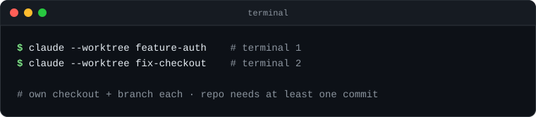

**When:** One task is running and the next one is ready.

<a id="rewind"></a>

### Esc Esc is undo

Double-tap `Esc` or run `/rewind` to roll code and conversation back to a checkpoint. Try the risky idea first.

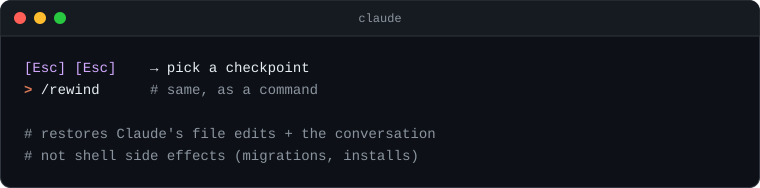

**When:** Experiments, big refactors, “let's just try it”.

<a id="screenshots"></a>

### Show, don't describe

Paste a screenshot of the broken UI instead of describing it. `Ctrl+V`, or `Alt+V` on Windows.

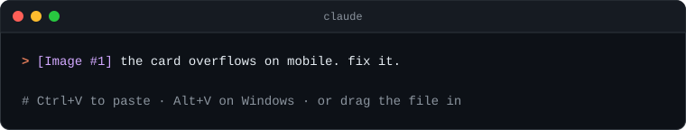

**When:** Frontend work, CSS bugs, design handoffs.

<a id="bang"></a>

### ! runs it yourself

Start a line with `!` to run a shell command directly. The output lands in context, and no tokens go into deciding to run it.

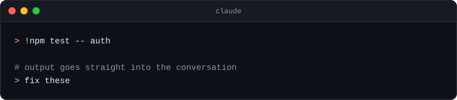

**When:** You already know the exact command.

<a id="code-review"></a>

### Review before you commit

`/code-review` hunts real bugs in the diff, and `--fix` applies them. `/security-review` for auth, payments, uploads.

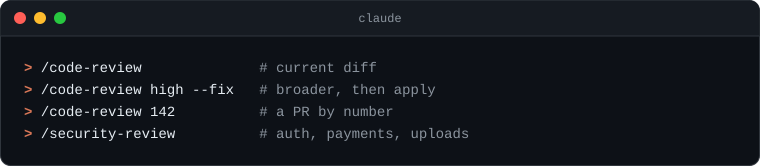

**When:** Every non-trivial diff.

## Automation

<a id="fewer-prompts"></a>

### End permission-prompt fatigue

`/fewer-permission-prompts` scans your past sessions and allowlists the read-only commands you always approve.

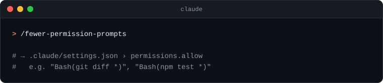

**When:** You click “Yes” on the same commands every day.

<a id="loop"></a>

### Babysit CI with /loop

`/loop` reruns a prompt on an interval while the session is open. Leave out the interval and Claude paces itself.

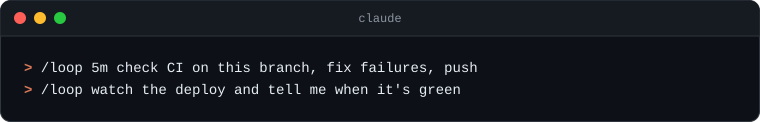

**When:** Waiting on CI, a deploy or a flaky queue.

<a id="routines"></a>

### Routines run while you sleep

`/schedule` creates a cloud routine with a cron, GitHub-event or API trigger. It pushes to `claude/` branches and opens PRs.

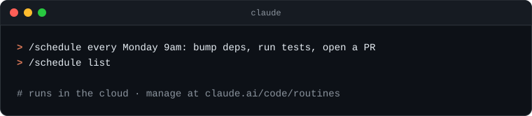

**When:** Recurring chores: dependency bumps, docs drift, PR review, triage.

<a id="insights"></a>

### Let /insights find your next hook

`/insights` builds an HTML report of your recent sessions. Whatever you keep doing by hand is your next hook or skill.

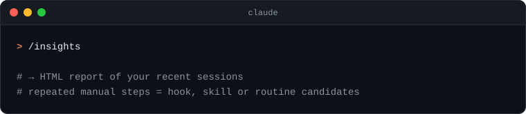

**When:** Once a month, or whenever your setup feels stale.

<a id="headless"></a>

### Pipe it: claude -p

`claude -p` behaves like any Unix tool. Drop it into scripts, git hooks and CI.

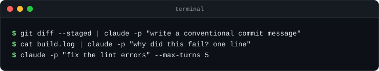

**When:** Anything you'd script: commit messages, log triage, batch edits.

## Keep it running

- **Nudge:** the plugin's session-start hook tells you when tips land that your repo hasn't seen yet.
- **Daily audit as a routine:** `/schedule daily: fetch https://raw.githubusercontent.com/fALECX/agentic-harness-tips/main/plugin/skills/audit/SKILL.md and follow it unattended`
- **Fresh list:** a daily routine reads the Claude Code changelog, checks new features against the docs and opens a PR here.

<sub>Source of truth is <code>tips.json</code>. README, images and the plugin copy are generated by <code>node scripts/build.mjs</code>.</sub>
